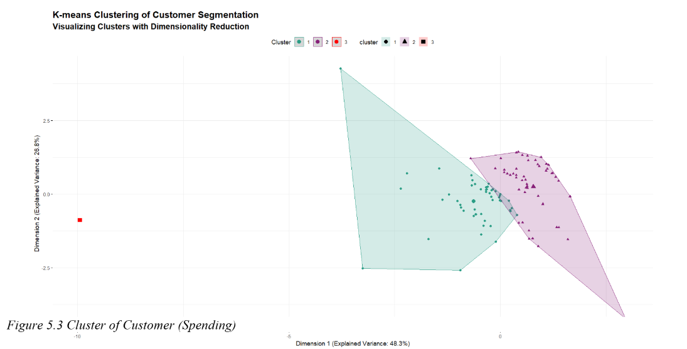
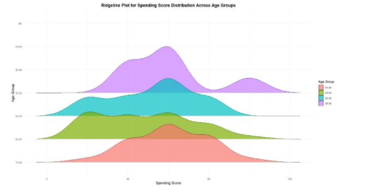
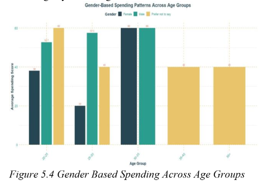
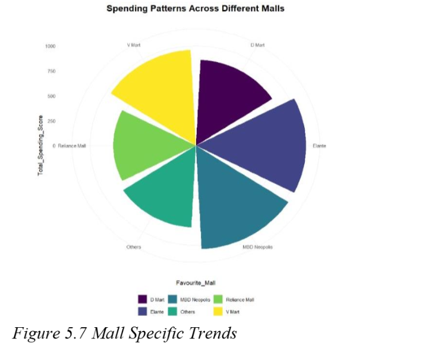
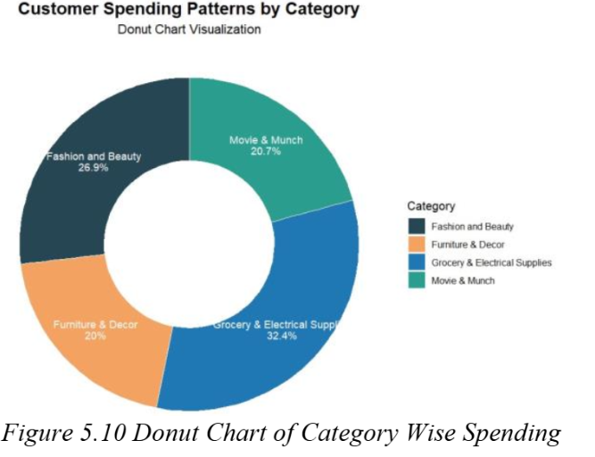

---
# Customer Segmentation Classification  

This project focuses on **Customer Segmentation Classification** using the **R programming language**. It applies various machine learning algorithms and techniques to gain insights from the data and predict customer categories effectively.

## **Project Overview**  
Customer segmentation is vital for understanding consumer behavior and targeting groups effectively. This project implements the following key techniques:  

- **Random Forest**  
- **Regression Analysis**  
- **Density-Based Spatial Clustering of Applications with Noise (DBSCAN)**  
- **Gradient Boosting Machine (GBM)**  
- **K-Means Clustering**

## **Tech Stack**  
- **Language**: R  
- **Libraries**: dplyr, ggplot2, caret, randomForest, fpc, gbm  

## **Dataset**  
The data includes the following features:  
- Age  
- Gender  
- Monthly Expenses  
- Loyalty Score (low, moderate, high)  
- Spending Score  
- Region  
- Timestamp  

## **Additional Resources**

The Tableau dashboard and presentation slides for this project are available in a separate repository.

- **[Tableau Dashboard & Presentation Slides](https://github.com/simrann0104/Customer-Segmentation-Classification)**

## Screenshots

## **Contributing**  
Contributions are welcome! Feel free to fork the repository and create a pull request.  

## **License**  
This project is licensed under the MIT License. See the LICENSE file for more details.

---
